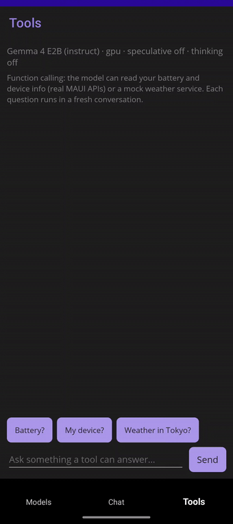

# Chat & generation

The core loop: load a `LiteRtEngine`, create a `LiteRtConversation`, send turns. This guide covers
the generation features in depth — function calling, reasoning mode, multimodal input, and token
counting. Conversation persistence has [its own guide](conversation-state.md), as do
[speculative decoding](speculative-decoding.md) and [engine tuning](engine-tuning.md).

```csharp
using LiteRtLmSharp;

using var engine = LiteRtEngine.Load(new LiteRtEngineOptions
{
    ModelPath = "gemma-4-E2B-it.litertlm",   // from huggingface.co/litert-community
    Backend = LiteRtBackend.Cpu,              // or .Gpu (WebGPU -> D3D12/Vulkan/Metal)
    MaxNumTokens = 4096,                       // total context window
});

using var chat = engine.CreateConversation();

// Blocking:
Console.WriteLine(chat.Send("Hello!").Text);

// Awaitable (pass a CancellationToken to cancel mid-generation):
Console.WriteLine((await chat.SendAsync("Hello!")).Text);

// Streaming: each piece is tagged (answer / thinking / tool call) — see Reasoning mode below.
await foreach (var chunk in chat.SendStreamingAsync("Tell me a joke"))
    Console.Write(chunk.Text);
```

## Function calling

```csharp
using var chat = engine.CreateConversation(new LiteRtConversationOptions
{
    Tools = [ new LiteRtTool("get_weather", "Get weather for a city",
        """{"type":"object","properties":{"location":{"type":"string"}},"required":["location"]}""") ],
    EnableConstrainedDecoding = true,
});

var r = chat.Send("Weather in Tokyo?");
if (r.IsToolCall)
{
    var results = r.ToolCalls.Select(c => new LiteRtToolResult(c.Name, RunTool(c)));
    Console.WriteLine(chat.SendToolResults(results).Text);
}
```

`EnableConstrainedDecoding` grammar-constrains the model's output to valid tool-call JSON. It is the
recommended setting when you use tools. Tools also work without it, but then nothing constrains the
arguments. When one prompt was sent 20 times with sampling, the arguments parsed and named the right city
in all 20 sends, both with and without constrained decoding. That test used LiteRT-LM v0.20.0 and
gemma-4 E2B on win-x64 CPU, with top-k 40, top-p 0.95 and temperature 1.0.

If you use the
[Microsoft.Extensions.AI or Semantic Kernel connectors](extensions-ai.md#function-calling-tools),
their auto-invocation layers sit on top of this same API.

<p align="center">
  
</p>
<p align="center"><sub>Function calling on a phone: the model calls the device's real battery API and answers with the result.</sub></p>

## Reasoning mode (thinking)

Models with a reasoning template (the Gemma builds) can be told to think before answering:

```csharp
using var chat = engine.CreateConversation(new LiteRtConversationOptions
{
    EnableThinking = true,   // Gemma reasoning mode (sets enable_thinking)
});
```

The runtime keeps the reasoning out of the KV cache by default, so setting `FilterThinkingFromKvCache` to
`true` is optional. With the property unset, a 966-token reply that held 668 thinking tokens left the
conversation at 339 tokens. This was measured with LiteRT-LM v0.20.0 and gemma-4 E2B on win-x64 CPU. On
the GPU, through the `IChatClient` adapter, which leaves the property unset, a 966-token reply that held
818 thinking tokens left the conversation at 189 tokens.

The reasoning trace comes back **separate** from the answer — on the blocking `Send` via
`response.Thinking` (and the full `response.Channels` map), and when streaming each
`LiteRtStreamChunk` is tagged by `Kind` (`Answer` / `Thinking` / `ToolCall`):

```csharp
await foreach (var chunk in chat.SendStreamingAsync("Why is the sky blue?"))
    Console.Write(chunk.IsThinking ? $"\n[thinking] {chunk.Text}" : chunk.Text);
```

`EnableThinking` reaches the chat template as extra context (`enable_thinking`). For arbitrary template
variables, use the raw `ExtraContext` (a JSON-object string) escape hatch. On a model whose template does
not use `enable_thinking`, the setting is a harmless no-op.

`LiteRtSendOptions.EnableThinking` overrides the setting for one send. On Gemma 4, a per-send `false` turns
thinking off on a later send too, but a per-send `true` turns it on only on the conversation's first send.
Measured with LiteRT-LM v0.20.0 on gemma-4 E2B, CPU and GPU:

| Per-send `EnableThinking` | Result |
|---|---|
| `true` on the first send of a conversation created without thinking | The model thinks. |
| `true` on a later send, after a first send without thinking | The model doesn't think. |
| `false` on a later send of a thinking conversation | The model answers without thinking. |

The `false` case works because the binding also suppresses the token that opens the thinking channel
(`<|channel>`) for that send; the runtime alone does not change the mode after the first send.

## Multimodal messages (image / audio)

On a multimodal model (the Gemma 4 E-series are text + vision + audio), enable the encoder backends at
load time and attach images or audio clips to a turn. The runtime detects each attachment's format from
its bytes, so no format hint is sent.

```csharp
using var engine = LiteRtEngine.Load(new LiteRtEngineOptions
{
    ModelPath = "gemma-4-E2B-it.litertlm",
    Backend = LiteRtBackend.Cpu,
    VisionBackend = LiteRtBackend.Cpu,   // enables image input; null = off
    AudioBackend = LiteRtBackend.Cpu,    // enables audio input; null = off
    MaxNumTokens = 4096,     // leave room for the media's tokens (an image is about 260 on this model)
});
using var chat = engine.CreateConversation();   // a plain conversation can send attachments

// Attach in-memory bytes (sent as a base64 blob) ...
byte[] png = File.ReadAllBytes("cat.png");
var reply = chat.Send("What is in this image?", [LiteRtAttachment.Image(png)]);

// ... or a file on disk (the binding passes only the path, and the native side opens the file):
chat.Send("Describe this photo.", [LiteRtAttachment.ImageFile("/photos/sunset.jpg")]);

// Audio works the same way; streaming has matching attachment overloads:
await foreach (var chunk in chat.SendStreamingAsync(
                  "Transcribe this.", [LiteRtAttachment.Audio(wavBytes)]))
    Console.Write(chunk.Text);
```

Attachments follow the text in content-part order; pass several to interleave them.

The following formats were tested with LiteRT-LM v0.20.0 (win-x64, CPU, gemma-4 E2B):

| Input | Decoded | Failed to decode |
|---|---|---|
| Image | PNG, JPEG | WEBP ("Failed to decode image. Reason: unknown image type.") |
| Audio | MP3, WAV, FLAC | OGG Vorbis ("Failed to initialize miniaudio decoder, error code: -10") |

For a file-path attachment, the binding passes only the path and the native side opens the file, so the
path must be readable by your app's process.

A file-path attachment gets the same reply as the same content sent as bytes. This was measured with
LiteRT-LM v0.20.0:

- On win-x64 (CPU, gemma-4 E2B), for `ImageFile` and `AudioFile` (MP3).
- On an Android x86_64 emulator (API 35, CPU), for `ImageFile`, both from the app's external files folder
  and from a copy in its internal files folder. `AudioFile` was not measured on Android.

By default, each image expands to about 256 tokens on the Gemma 4 E-series (260 measured on
gemma-4-E2B-it). To spend less of the context
window, set a per-image budget: the runtime scales the image down to about the budget in tokens, never
above its default size (measured on gemma-4-E2B-it: budgets of 70, 100 and 200 cost 68, 104 and 200
tokens).

```csharp
using var chat = engine.CreateConversation(new LiteRtConversationOptions
{
    VisualTokenBudget = 70,   // measured on gemma-4-E2B-it: 68 tokens per image instead of 260
});
```

`LiteRtSendOptions.VisualTokenBudget` overrides it for one send. The budget must not exceed the engine's
per-image maximum: `LiteRtEngineOptions.MaxVisionTokensPerImage` when you set it, else the model's own
(`LiteRtModelInfo.MaxVisionTokenBudget`, 280 on the Gemma 4 E-series). An image send over it fails with
`LiteRtStatusCode.InvalidArgument`; the binding attaches the budget only to sends that carry an image, so
text-only sends are unaffected. With a cap below the default size, every image send needs a budget at or
below the cap. Vision runs on CPU or GPU; some models constrain their audio backend (Gemma 4's audio sub-model requires CPU, so
`AudioBackend = LiteRtBackend.Gpu` fails engine creation for it on any platform) — keep audio on CPU when the main
backend is GPU.

A plain `CreateConversation()` can send attachments, and you don't have to set a sampler or output cap.
The runtime loads the vision encoder only for a conversation created with a conversation configuration, so
on a multimodal engine the binding always passes one. The runtime behavior was measured with LiteRT-LM
v0.20.0 and gemma-4 E2B on win-x64, CPU and GPU. Give `MaxNumTokens` room for the media's tokens (an image is about
260 on gemma-4-E2B-it). If a send still hits a multimodal-setup problem, the binding throws a `LiteRtException`
naming the likely causes (model not multimodal, `VisionBackend` / `AudioBackend` unset, or
`MaxNumTokens` too small). The MAUI sample's Chat tab exposes 📷 / 🎵 attach buttons (and a modality indicator) for capable models.
Wire-format and validation details:
[native-abi.md](native-abi.md#multimodal-messages-image--audio--verified-wire-format).

## Token counting (tokenize / detokenize)

Measure a prompt's exact token cost, or convert between text and token ids, without running
inference. Useful for budgeting against `MaxNumTokens` before sending.

```csharp
int[] ids = engine.Tokenize("How many tokens is this?");
Console.WriteLine($"{ids.Length} tokens");      // exact count, no generation
string text = engine.Detokenize(ids);           // back to text

// The model's start (BOS) and stop (EOS) tokens, each a literal string or a sequence of ids:
foreach (var stop in engine.GetStopTokens())
    Console.WriteLine(stop);                     // e.g. an EOS token id like [1]
```

These call the model's own tokenizer, so the counts match what generation sees. `Tokenize` returns the
raw ids, with no chat template: "The quick brown fox." gives 5 ids, with no BOS or turn markers.
`Detokenize` returns plain text: the round trip gives back the same string, with ordinary spaces
(measured with LiteRT-LM v0.20.0, win-x64, CPU, gemma-4 E2B). A start/stop token is a `LiteRtTokenUnion`
carrying either `Text` or `Ids` (its `Kind` says which).

A common use is keeping a conversation inside its context window. The window holds the whole chat
(prompt plus replies, across turns). What happens when it fills depends on whether you set
`MaxNumTokens`:

- With `MaxNumTokens` set, the binding clamps each reply to the remaining context and throws
  `LiteRtContextOverflowException` when the conversation is full.
- Without that guard, the runtime stops a reply at the limit and rejects later sends. A send whose
  prefill doesn't fit can leave the conversation failing every later send. This was measured with
  LiteRT-LM v0.20.0 and gemma-4 E2B on win-x64, CPU and GPU.

In either case, measure the next turn in real tokens and react before sending instead of guessing by
string length:

```csharp
// contextWindow is the MaxNumTokens you loaded with; leave headroom for the reply.
int next = engine.Tokenize(message).Length;
if (chat.TokenCount + next > contextWindow - replyHeadroom)
    // won't fit: warn the user, shorten the message, or drop old turns and reload via History.
    Warn("Context almost full — shorten the message or start a new chat.");
```

`Tokenize` counts the raw text; for the exact per-turn cost with the chat template included, render the
message first with `chat.RenderMessage(text)` (it returns the templated prompt without sending), then
tokenize that: `engine.Tokenize(chat.RenderMessage(text)).Length`.

## Read a model's metadata

`LiteRtModelInfo.Read` opens a `.litertlm` file, reads what it declares and closes it, without loading an
engine. Use it before a load to reject a file that is not a chat model, to size `MaxNumTokens`, or to show
which inputs and backends a model supports. Reading the file takes little memory (LiteRT-LM v0.20.0,
win-x64, gemma-4-E2B-it).

```csharp
LiteRtModelInfo info = LiteRtModelInfo.Read("gemma-4-E2B-it.litertlm");

if (info.ModelType != LiteRtModelType.LanguageModel)
    throw new InvalidOperationException("Pick a chat model.");
Console.WriteLine($"context: {info.MaxContextTokens} tokens (configurable: {info.IsDynamicContext})");
Console.WriteLine($"inputs: {string.Join(", ", info.InputModalities)}");   // Text, Vision, Audio
foreach (var (modality, backends) in info.SupportedBackends)
    Console.WriteLine($"{modality}: {string.Join(", ", backends)}");        // Text: cpu, gpu ...
```

The metadata is only as complete as the file: every field is optional, and the litert-community builds we
test with declare few of them. The following values were read with LiteRT-LM v0.20.0 on win-x64:

| File | `MaxContextTokens` | Speculative decoding | Inputs | Thinking, tools, default sampler |
|---|---|---|---|---|
| gemma-4-E2B-it | 4,096 (dynamic) | Yes | Text, vision, audio | Not declared |
| gemma-4-E4B-it | 4,096 (dynamic) | Yes | Text, vision, audio | Not declared |
| Phi-4-mini-instruct | 4,096 (static) | No | Text | Not declared |
| Ministral-3-3B-Instruct | 4,096 (static) | No | Text | Not declared |

So read `false`, `0` or `null` as "not declared", not as "not supported": gemma-4-E2B-it reasons and calls
tools although its file declares neither. `SupportedBackends` is a declaration too: it repeats what the
file states.

`MaxContextTokens` is not always a hard maximum. gemma-4-E2B-it, which declares a dynamic context of
4,096 tokens, accepted 19,533 tokens with `MaxNumTokens = 20000`. That was measured with LiteRT-LM v0.20.0
on win-x64 CPU, calling the native API directly, without the binding's overflow guard. Other
dynamic-context models were not measured.

The other fields are `DefaultSampler`, `VisionTokenSizes` and `MaxVisionTokenBudget` (the per-image token
sizes for `VisualTokenBudget`: 70, 140 and 280 on gemma-4-E2B-it), `MinRuntimeVersion`, and, for embedding
models, `EmbeddingDimension` and `EmbeddingInputLengths` (see [Embeddings](embeddings.md)).

## Runnable demos

See [`samples/Console`](https://github.com/OrihuelaConde/LiteRtLmSharp/tree/master/samples/Console)
(`--tools` for the function-calling loop, `--spec` for speculative decoding, `--thinking` for
reasoning mode) and
[`samples/Maui`](https://github.com/OrihuelaConde/LiteRtLmSharp/tree/master/samples/Maui) for a
full Android/Windows chat app with model download, streaming, tools and multimodal attachments.
